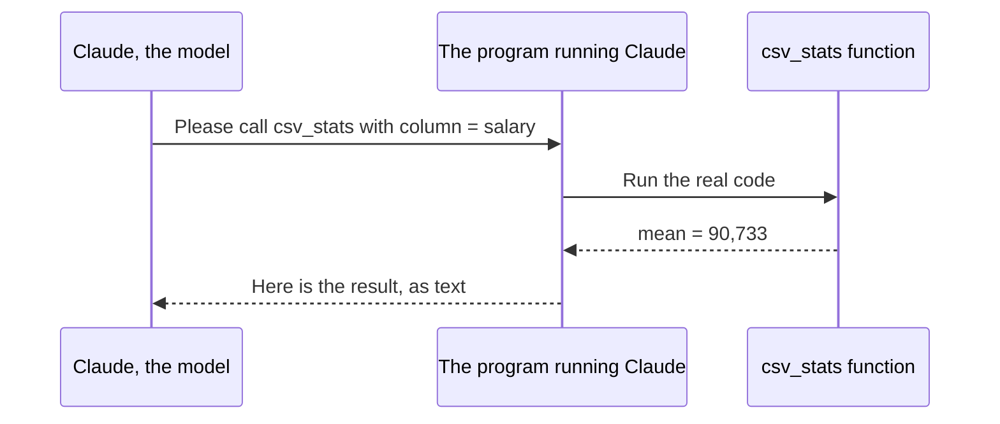
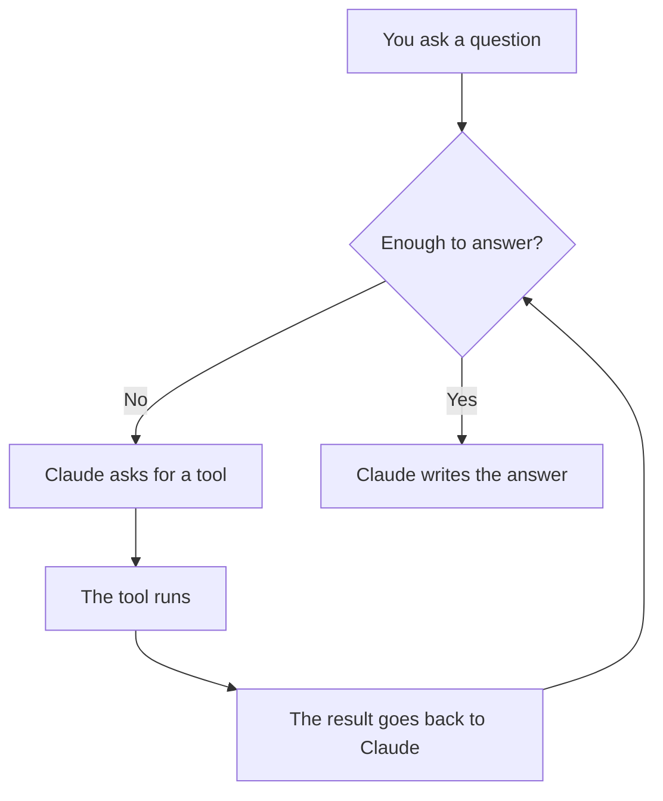
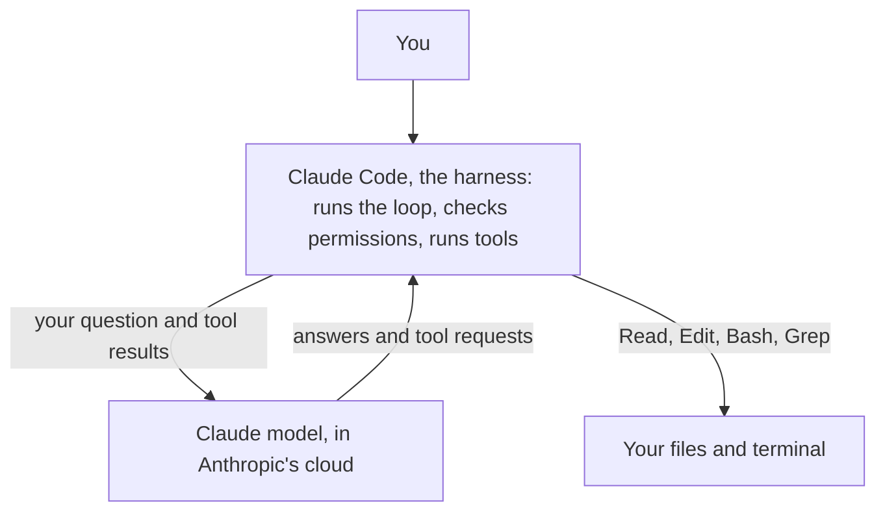
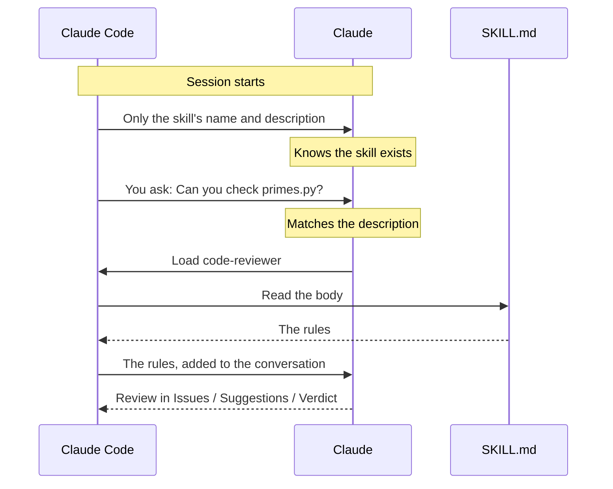
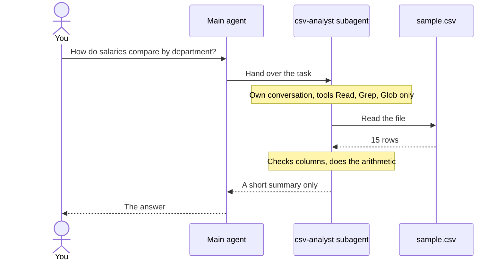
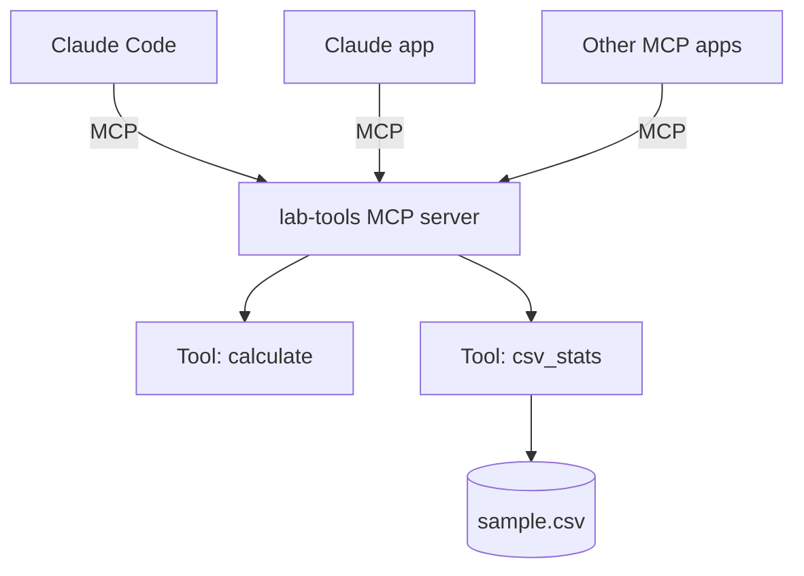
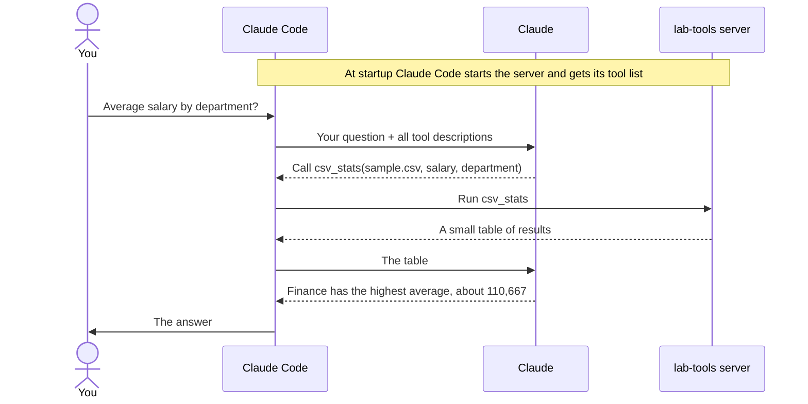
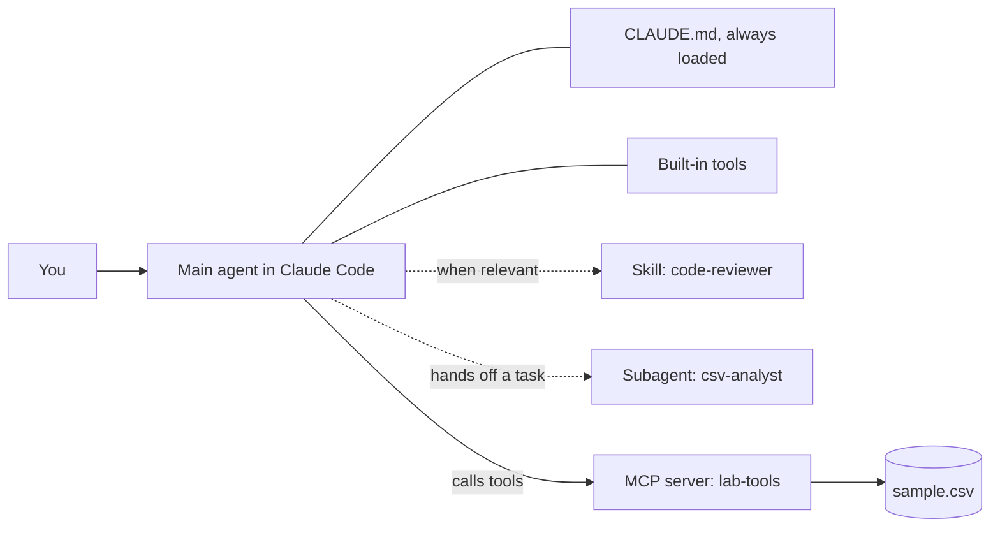
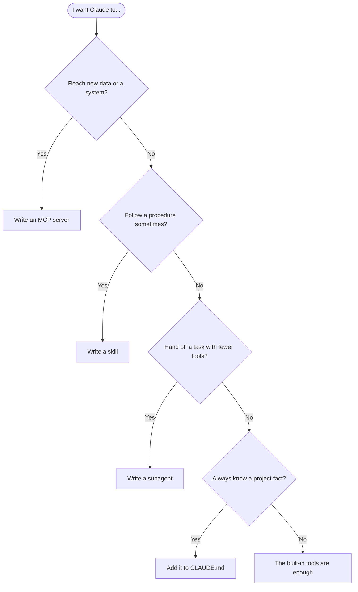
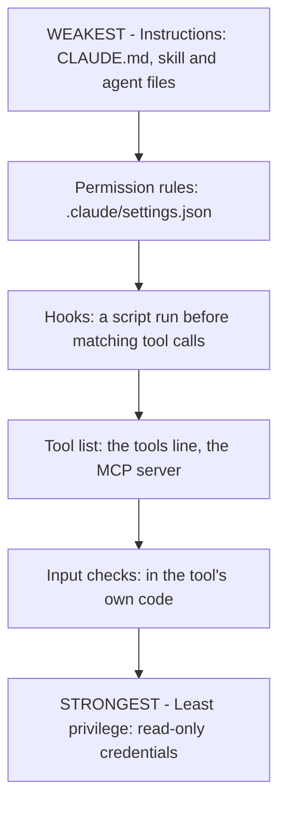

# Intro to agents: skills, subagents and MCP servers

**For:** junior developers and students who are new to AI agents
**Reading time:** about 20 minutes
**Worked example:** the lab in [`labs/06_claude_agents/`](../labs/06_claude_agents/LAB.md)

You have used a chat assistant. This guide explains what changes when the assistant
stops only *answering* and starts *doing things*: reading files, running code, calling
your systems. It builds up one idea at a time, and each idea points to the lab step
where you saw it.

By the end you should be able to explain, in your own words:

- what a **model**, a **tool**, an **agent** and a **harness** are
- the difference between a **skill**, a **subagent** and an **MCP server**, and when to use each
- why **what an agent can't do** matters more than what you tell it

---

## Part 1: The four basic ideas

### 1. A model only writes text

Claude is a **model**. You send it text, it sends text back. That's all it can do on its
own. It can't open a file, run a query, or see today's data.

Ask a plain chat "what's the average salary in my CSV?" and the honest answer is "I can't
see your file." Not because it isn't smart enough: it has no way to reach the file.

### 2. A tool is one thing the model may ask for

A **tool** gives the model a way to reach something. Every tool has three parts:

| Part | Example from the lab |
|---|---|
| A **name** | `csv_stats` |
| A **description**, in plain English | "Compute count, mean, min and max for one numeric column of a CSV. Use this instead of reading the whole file when the question asks for an average…" |
| **Inputs** | `path`, `column`, and optionally `group_by` |

The important part: **the model never runs a tool itself.** It writes a *request*
("please call `csv_stats` with `column = salary`"), and a separate program runs it and
sends back the result as text.



Two consequences you'll meet again:

- The model can only ask for tools **on its list**. That makes the list a safety boundary.
- The **description is all the model knows** about a tool. A vague description gives you
  an agent that picks the wrong tool. Write it the way you'd explain it to a new teammate.

### 3. An agent is a model in a loop

An **agent** is a model that keeps going: it reads the question, asks for a tool, reads
the result, and decides again, until it can answer.



This loop goes by several names: the **agent loop**, or **ReAct** (reason + act):
think → act → observe → repeat.

**Nobody writes the steps in advance.** The model picks them, fresh for each question,
from the tool descriptions. That's the difference from a script:

| A script | An agent |
|---|---|
| Runs the same steps every time | Works out the steps for each question |
| You can predict exactly what it does | You can't predict every step, so you check its work |
| Breaks on a question it wasn't written for | Can handle questions nobody planned for |

> **Lab step 1.** You asked "Which department has the highest average salary?" and
> watched Claude decide on its own to read the file and run some Python.

### 4. The harness runs the loop

The program that runs the loop is the **harness**. It sends your question to the model,
runs the tools the model asks for, and asks your permission before risky ones.

**Claude Code** is a harness. So is the **Claude app** (claude.ai). So is the short Python
script in the lab's `take-home/` folder. Same model, different harnesses, different tools.



Notice where the model lives: in the cloud. **Whatever a tool returns is sent to the
model.** If a tool reads a file, the file's contents travel to Anthropic's servers. Keep
that in mind before pointing an agent at real data.

---

## Part 2: Four ways to give Claude abilities

Out of the box, Claude Code already has **built-in tools**: it can read and edit files and
run shell commands. Everything else in this part is a way to add to or narrow that.

Three ideas often get mixed up, so here they are side by side before the details:

| | **Skill** | **Subagent** | **MCP server** |
|---|---|---|---|
| In one line | Know-how Claude loads when relevant | A helper agent with a narrow job | A program that offers new tools |
| What you write | A Markdown file | A Markdown file | A small program (Python here) |
| Gives Claude | Instructions (and optionally scripts, templates) | A separate worker with its own instructions and tools | New tools it couldn't use before |
| Analogy | A page in the team handbook | A specialist colleague you hand a task to | A new plug socket for a system |
| In the lab | Step 2: `code-reviewer` | Step 3: `csv-analyst` | Step 4: `lab-tools` |

The short version:

- A **skill** changes **how** Claude does something.
- A **subagent** changes **who** does it, and with which tools.
- An **MCP server** changes **what** Claude can reach.

### Skills: know-how, loaded when relevant

A **skill** is a folder with a `SKILL.md` file. The file has a short header and a body:

```markdown
---
name: code-reviewer
description: Reviews Python code for bugs, security problems and readability. Use when the user asks to review or check Python code.
---

# Python code reviewer
- Always answer in three sections: Issues, Suggestions, Verdict.
- ...
```

The clever part is **when** each piece is read:



Because only the description is loaded up front, you can have dozens of skills without
filling Claude's memory. The body costs nothing until it's needed. This is why **the
description decides whether the skill is used**: it must say *when* to use it.

Two things that surprised people in the lab:

- **A skill only shapes the answer; it doesn't give Claude new powers.** The code reviewer
  still used Claude's built-in Read tool to open the file.
- **Edits apply to new conversations.** Once a skill has been loaded into a conversation,
  that copy stays as it was. Type `/clear` to start fresh and pick up your edit.

> **Lab step 2.** You turned a plain prompt file into a skill, asked "Can you check
> primes.py?" without naming it, and saw "code-reviewer · Loaded skill".

### Subagents: a helper with a narrow job

A **subagent** is a separate agent with its own instructions and **its own list of
allowed tools**. It's a Markdown file too:

```markdown
---
name: csv-analyst
description: Answers questions about CSV files in this folder. Read-only.
tools: Read, Grep, Glob
---

You are a data analyst. Read the CSV and check its columns before computing anything...
```

Two ideas make subagents useful.

**1. Its own tool list.** The `tools:` line is a hard limit, not a suggestion. `csv-analyst`
has no Bash and no Edit, so it **cannot** delete a file, however nicely it's asked.

**2. Its own context.** The main agent hands a subagent a task. The subagent works in its
own separate conversation, reading as much as it needs, and only its **summary** comes back.
The main conversation stays short and focused.



In the lab you ran the subagent directly with `claude --agent csv-analyst`, so the whole
session *was* that agent. In normal use, the main agent decides on its own to hand a
matching task to a subagent, based on the subagent's `description`. Same idea as skills:
the description says when.

> **Lab step 3.** You asked `csv-analyst` to delete `sample.csv`. It refused: not because
> it was told to, but because it had no tool that could.

### MCP servers: new tools from outside

**MCP** (Model Context Protocol) is a standard way for a program to offer tools to an AI
app. An **MCP server** is such a program. The app (Claude Code, the Claude app, or others)
connects to it, asks what tools it has, and calls them by name.

A common comparison is USB-C: one standard plug, and any app that speaks MCP can use any
MCP server.



In Python, one tool is one decorated function. The function name, its typed inputs and
its docstring become the tool's name, inputs and description:

```python
@mcp.tool()
def csv_stats(path: str, column: str, group_by: str | None = None) -> str:
    """Count, mean, min and max for one numeric column of a CSV. Use this instead
    of reading the whole file when the question asks for an average or a total."""
    ...
```

Here's what happened in lab step 4 when you asked for average salary by department:



Why build an MCP server instead of letting Claude run Python through its shell?

- **It works anywhere.** The same server works in Claude Code, the Claude app, and other apps.
- **It's narrower.** Claude can call only the tools you wrote, not anything a shell can do.
- **You control the inputs.** The server's code checks every input before acting. The
  solution version of `csv_stats` refuses any path outside the lab folder.

> **Lab step 4.** You registered `lab-tools`, saw it under `/mcp`, added `csv_stats`, and
> checked that Claude used it for averages but not for "who is the youngest employee?".

### How they fit together

These aren't competing options. One Claude Code session can use all of them at once:



### Which one should I use?



A good habit: **start with the simplest thing that works**, and move to the next only when
you need to. Try an idea with built-in tools first; reach for an MCP server when other
people will rely on it.

---

## Part 3: What keeps an agent safe

### Instructions are not a safety mechanism

An agent told "never delete data" will *usually* comply. "Usually" isn't good enough for
anything that matters. Real safety comes from what the agent **cannot** do.

The protections in this lab, from weakest to strongest:



| Layer | Can the model talk its way past it? |
|---|---|
| Instructions | Yes, sometimes. It's text the model reads, like everything else |
| Permission rules | No, but a person can click "allow" without reading |
| Hooks | No: the script runs every time |
| Tool list | No: a tool that isn't listed can't be called |
| Input checks | No: the code runs regardless of what the model wants |
| Least privilege | No: a read-only database login can't delete, whoever asks |

> **Lab step 5.** You sent `().__class__.__base__.__subclasses__()` to the starter
> calculator and got back Python's internals. The tool *said* it was restricted, but the
> code allowed it. The fix lives in the server's code, not in a prompt.

### Rules for your own agents

1. **Give the agent the least it needs.** A read-only login beats a careful prompt.
2. **Keep secrets out of reach.** Tools should read keys themselves and never print them,
   so the model never sees them.
3. **Know where the data goes.** Tool results are sent to the model. Use test data until
   someone responsible has approved real data.
4. **Read the approval prompts.** Approve one tool or server at a time, never "all".
5. **Check the work.** Ask the agent how it got each answer, and rerun anything important.

---

## Part 4: Common confusions

**"Is a subagent a different AI?"**
Usually it's the same kind of model, just started fresh with different instructions and a
shorter tool list. What makes it different is its context and its limits, not its brain.

**"If a skill and a subagent are both Markdown files, what's the difference?"**
A skill adds instructions to the *current* conversation. A subagent starts a *separate*
conversation with its own tool list. Use a skill to change how something is done; use a
subagent to change who does it and what they're allowed to touch.

**"Why not put everything in CLAUDE.md?"**
`CLAUDE.md` is loaded into every conversation, so everything in it costs space every time.
Keep it to short facts and rules that always apply. Procedures you need only sometimes
belong in a skill.

**"Why did the agent ignore my skill?"**
Almost always the description: it didn't match how you asked. Make it say *when* to use
the skill, in words people actually type. Check `/skills` to see it's listed, or run it
directly with `/skill-name`.

**"The agent struggles with a question. Should I write a longer prompt?"**
Usually not. Give it a better tool. In the lab, `csv_stats` returns a small exact table
instead of making Claude read and add up the whole file.

---

## Glossary

| Term | Meaning |
|---|---|
| **Model** | The AI that reads and writes text. Here, Claude |
| **Tool** | One action the model may ask for: a name, a description and inputs |
| **Agent** | A model working in a loop with tools until it can answer |
| **Agent loop / ReAct** | Think → act (call a tool) → observe the result → repeat |
| **Harness** | The program that runs the loop and the tools: Claude Code, the Claude app, or your own code |
| **Context** | Everything the model can see in one conversation: instructions, messages, tool results |
| **Skill** | A `SKILL.md` file of instructions Claude loads when its description matches the request |
| **Subagent** | A helper agent with its own instructions, tool list and context, defined in `.claude/agents/` |
| **MCP** | Model Context Protocol: a standard way for programs to offer tools to AI apps |
| **MCP server** | A program that offers tools through MCP, like `lab-tools` |
| **`CLAUDE.md`** | Project memory Claude Code loads at the start of every session |
| **Permission rule** | A setting that says which tool calls may run without asking you |
| **Hook** | A script Claude Code runs automatically before or after certain tool calls |

## Where to go next

- Redo the lab steps you rushed, using this guide alongside [`LAB.md`](../labs/06_claude_agents/LAB.md).
- Take-home B in the lab writes the agent loop yourself in about 40 lines of Python. It's
  the best way to see that there's no magic in it.
- Claude Code documentation: [skills](https://code.claude.com/docs/en/skills),
  [subagents](https://code.claude.com/docs/en/sub-agents) and
  [MCP](https://code.claude.com/docs/en/mcp).
